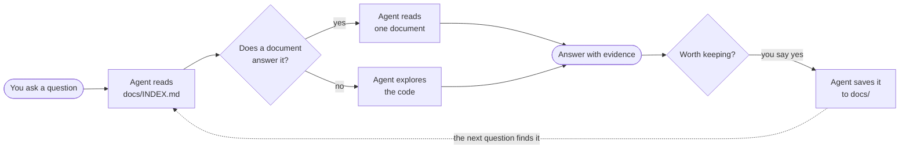
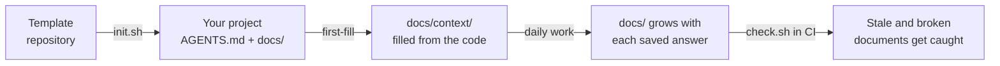
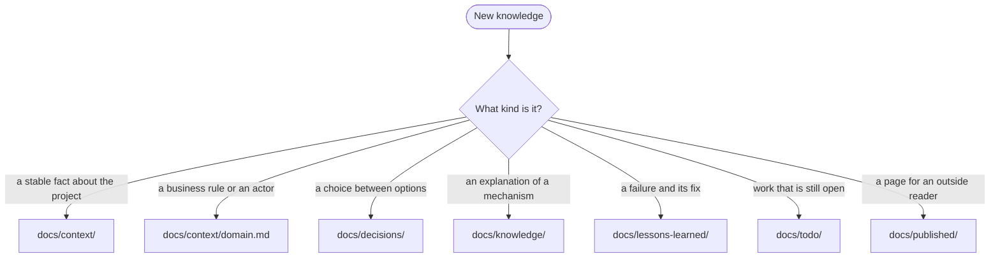
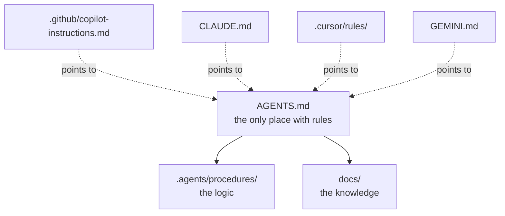

# repo-memory

**A project memory for AI coding agents.** It is a set of Markdown files that
lives in your repository, next to the code. The agent reads it before it reads
the code, and writes to it when it learns something.

It works with **GitHub Copilot, Claude Code, Cursor, Gemini CLI, Codex**, and
every other agent that reads `AGENTS.md`. It needs no server, no database, and
no plugin. It needs `bash` and `git`.

---

## The problem

An AI agent starts every session with an empty memory.

- You ask how the checkout works. The agent scans fifty files and answers.
- The next day you ask again. The agent scans the same fifty files.
- A colleague asks the same question. The agent scans them a third time.
- Nobody recorded why the team rejected the other design. The agent proposes it again.

The answer was correct each time. The work to find it was lost each time.

## The idea

Write the answer down once, in a place the agent looks first.



Each saved answer makes the next question cheaper. After some weeks, the
`docs/` folder holds how the project works, why it is built that way, and what
breaks. That folder is the **memory** of the repository.

---

## Quick start

You need two commands. Run them from the root of your project.

```bash
git clone --depth 1 <url-of-this-repository> /tmp/repo-memory
/tmp/repo-memory/bootstrap/init.sh . --tools copilot
```

The script does four things:

1. **Detects** the project facts: the name, the repository URL, the default
   branch, and the build and test commands.
2. **Asks** only for the facts that no file can answer. Usually these are the
   purpose, the owner, and the documentation language.
3. **Copies** the knowledge base into your project. It skips every file that
   already exists. It deletes nothing.
4. **Checks** the result with `bootstrap/check.sh`.

Then open your agent and give it one instruction:

> Follow `.agents/procedures/first-fill.md`.

With Copilot, type `/first-fill` in the chat. The agent reads your code and
fills `docs/context/` with the architecture, the conventions, the toolchain,
and the business rules. It cites a file and a line for each fact.



### Options of `init.sh`

| Option | Effect |
|---|---|
| `--tools copilot,cursor` | Adds the files for those tools. Values: `copilot`, `claude-code`, `cursor`, `gemini`, `all`, `none`. |
| `--profiles kafka,jira` | Adds optional rule sets. Values: `kafka`, `monolith-extraction`, `obsidian`, `jira`. |
| `--set KEY=VALUE` | Sets one project fact. `bootstrap/placeholders.yml` lists the keys. |
| `--yes` | Asks no question. Use it in a script or in CI. |
| `--force` | Replaces a file that already exists. |

A full install with no questions:

```bash
/tmp/repo-memory/bootstrap/init.sh . --yes --tools copilot \
  --set PROJECT_PURPOSE="Calculates order totals for the checkout." \
  --set CODE_OWNER="Checkout team"
```

---

## What you get

```text
your-project/
├── AGENTS.md              the rules. Every agent reads this file first.
├── .agents/procedures/    step-by-step procedures in plain Markdown
├── .github/               Copilot instructions and prompt files (--tools copilot)
├── bootstrap/check.sh     the health check
└── docs/
    ├── INDEX.md           generated list of all documents — the agent starts here
    ├── context/           what the project is
    ├── decisions/         why it is built this way
    ├── knowledge/         how it works
    ├── lessons-learned/   what breaks, and how to react
    ├── todo/              what is still open
    ├── published/         what the stakeholders read
    └── sessions/          what happened in earlier sessions
```

### One folder for one kind of question

A document goes where its question belongs. The agent uses the same rule to
find it again.



### Every document carries its own status

Each file under `docs/` starts with a short header:

```yaml
---
title: Order checkout data flow
type: knowledge
status: draft          # draft | current | superseded
updated: 2026-11-12
sources:
  - src/checkout/CheckoutService.java:142
---
```

- **`status`** tells the reader how much to trust the document. `draft` means
  the agent read the code. `current` means someone verified it.
- **`sources`** lists the evidence. The check fails when a source file no
  longer exists, so a refactor cannot silently leave a document behind.

---

## Daily use

You do not change how you work. The agent follows `AGENTS.md`.

| Situation | What happens |
|---|---|
| You ask a technical question | The agent reads `docs/INDEX.md`, then the matching document, then the code if needed. |
| The agent gives a substantial answer | It asks one line: `Save this to docs/knowledge/?` You decide. |
| A design choice gets made | The agent writes a decision record with the rejected options. |
| Something breaks in an environment | The agent looks for an existing playbook first, then extends it. |
| A code change makes a document wrong | The agent updates that document in the same change. |
| The session ends | The agent writes a handoff entry, so the next session can continue. |

The agent never commits or pushes on its own. It leaves the changes in the
working tree, and you review them like code.

### The procedures

Each procedure is a numbered list in plain Markdown. A person can follow it too.

| Procedure | Use it when | Copilot prompt |
|---|---|---|
| `first-fill.md` | The knowledge base is new and empty | `/first-fill` |
| `save-knowledge.md` | An answer is worth keeping | `/save-knowledge` |
| `write-adr.md` | A decision gets made | `/write-adr` |
| `pre-commit-review.md` | A code change is finished | `/pre-commit-review` |
| `incident-playbook.md` | Something broke in a running environment | `/incident-playbook` |
| `session-handoff.md` | The session ends | `/session-handoff` |

---

## Keeping it true

A knowledge base that is wrong is worse than none. `bootstrap/check.sh` fails
when:

- a `{{PLACEHOLDER}}` is still unfilled,
- a document under `docs/` has no header, or the header misses a field,
- a path in `sources:` does not exist in the repository,
- a file contains the absolute path of one machine,
- a decision record is missing from the decision index,
- `docs/INDEX.md` is out of date.

It warns when a document stays `draft` for more than 90 days.

Run `bootstrap/check.sh --index` to regenerate the index. The template includes
a GitHub Actions workflow that runs the check on each pull request.

---

## How one rule file serves every tool

The rules live in `AGENTS.md`, and only there. A tool that needs its own file
gets a short stub that points to `AGENTS.md`.



When you change tools, you keep `AGENTS.md`, the procedures, and `docs/`. You
run `init.sh` again with a different `--tools` value to add the new stubs.

---

## Optional profiles

A profile is a small rule set for one technology or one way of working. The
agent reads it only when it works on that subject.

| Profile | Enable it when |
|---|---|
| `kafka` | The project consumes or publishes Kafka topics |
| `monolith-extraction` | The project moves an area out of a monolith. It adds `docs/analysis/`. |
| `obsidian` | The team reads `docs/` in Obsidian |
| `jira` | The agent writes ticket text and the team uses Jira |

---

## Upgrading

```bash
git -C /tmp/repo-memory pull
/tmp/repo-memory/bootstrap/sync.sh .
```

`sync.sh` refreshes the check script, the procedures, and the prompt files. It
does not change `AGENTS.md` or anything under `docs/`. It lists the template
files that changed, and you merge them yourself.

---

## Questions

**Does the agent write to my repository without asking?**
No. It asks before it saves a document, and it never commits.

**Does this work without Copilot?**
Yes. Every agent that reads `AGENTS.md` follows the same rules. Without a tool
option, you get `AGENTS.md`, the procedures, and `docs/`.

**My project already has a `docs/` folder.**
`init.sh` skips each file that exists. Your files stay as they are.

**Can I combine the knowledge bases of several repositories?**
Yes. Every document has the same header, and every repository has a
`docs/INDEX.md`. A script or an agent can read those across repositories.

**In which language does the agent write?**
In the language you give for `DOC_LANGUAGE` during the install.

---

## License

MIT. See [`LICENSE`](LICENSE).
